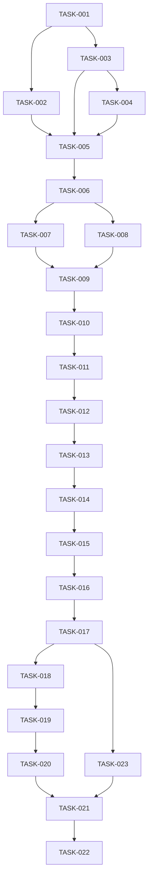

# Backlog executável — Tropa Fight

Estados permitidos: `BLOCKED | READY | IN_PROGRESS | IN_REVIEW | DONE | FAILED | CANCELLED`.

Toda TASK herda a DoD global de `AGENTS.md`: build, lint e testes aplicáveis aprovados, critérios atendidos, rastreabilidade preservada, Scope Guard validado e estado atualizado.

Política incidental padrão:

`MINIMAL_DIRECTLY_CAUSED_CHANGES_ALLOWED`

Nenhuma TASK pode iniciar automaticamente outra TASK após sua conclusão.

## Mapeamento de referências legadas

Por decisão de 2026-11-11 (DIV-001 e DIV-002), os IDs oficiais são os do `README.md`. As TASK-001 a TASK-017 foram registradas com referências que, em parte, têm outro significado. O texto histórico **não foi alterado**. Para rastreabilidade, use a coluna "IDs oficiais".

| TASK | Referências registradas (legadas) | IDs oficiais |
| --- | --- | --- |
| 001 | RNF-001, RNF-002, RNF-013 | RNF-016, RNF-017, RNF-018 (fundação de qualidade e camadas) |
| 002 | RNF-011, RNF-012, RNF-018 | RNF-011, RNF-012, RNF-013, RNF-019 |
| 003 | RF-001, RN-001, RN-002, RNF-004, RNF-005, UC-001 | RF-001; RN-016, RN-018; RNF-004, RNF-006, RNF-009; UC-001–003 |
| 004 | RF-023, RF-024, RF-026, RNF-006–008 | RF-019, RF-028; RN-019; RNF-007, RNF-013, RNF-015; UC-021, UC-023 |
| 005 | RNF-001–018 (com RNF-010 e RNF-014–017 redefinidos) | RNF-001–018 originais e RNF-019–023 |
| 006 | RF-003–006, UC-002 | RF-003, RF-004, RF-006, RF-020, RF-021; RN-006; UC-004, UC-005, UC-014 |
| 007 | RF-007, RF-008, RF-021, RN-004, RN-005, UC-003 | RF-007, RF-020; RN-002; UC-005, UC-014 |
| 008 | RF-009–012, UC-002, UC-003 | RF-003, RF-005; UC-004 |
| 009 | RF-013, RF-014, RN-006, RN-007, UC-010 | RF-015, RF-016, RF-022; RN-003, RN-004, RN-007; RNF-010; UC-015 |
| 010 | RF-003–014, RN-004–007, UC-002, UC-003, UC-010 | Somatório das TASK-006 a TASK-009 acima |
| 011 | RF-015–017, RN-008, RN-009, UC-004 | RF-008; RN-002, RN-003; UC-006, UC-007 |
| 012 | RF-018, RF-019, RN-010, UC-005 | RF-009, RF-026; RN-013, RN-014; UC-018 |
| 013 | RF-020–023, RN-011, RN-012, UC-006 | RF-002, RF-010, RF-012; RN-003, RN-004, RN-005, RN-012; RNF-010; UC-008, UC-010 |
| 014 | RF-024, RF-025, RN-013, RNF-009 | RF-011; RN-008–011; RNF-008; UC-009 |
| 015 | RF-026–028, RN-014, UC-007, UC-008 | RF-012, RF-013, RF-014, RF-023; RN-008, RN-018; RNF-009; UC-011, UC-016 |
| 016 | RF-015–028, RN-008–014, UC-004–008 | Somatório das TASK-011 a TASK-015 acima |
| 017 | RF-029, RF-030, RN-015, RN-016, UC-009 | RF-017, RF-018; RN-015, RN-021; RNF-009; UC-012, UC-013 |

As TASK-018 a TASK-023 já usam IDs oficiais. Nos relatórios detalhados (`docs/TASKS/TASK0nn.MD`) e nos checkpoints, as referências também são legadas e devem ser lidas por esta tabela.

## Convenção de registro de execução

A partir de 2026-11-11 (DIV-011), as etapas do fluxo de prompts (`prompts/tasks/`) são registradas como **ETAPA-001 a ETAPA-006**. O termo "Gate" fica reservado aos Quality Gates do `AGENTS.md` (Build, Lint, Unit, Integration, API, Security, Acceptance, Regression). Os registros anteriores que usam "GATE-001–006" referem-se a etapas e não foram reescritos.

## Índice de execução

| Ordem | TASK     | Fase     | Prioridade | Dependências               | Estado  |
| ----: | -------- | -------- | ---------- | -------------------------- | ------- |
|     1 | TASK-001 | PHASE-01 | CRITICAL   | NONE                       | DONE    |
|     2 | TASK-002 | PHASE-01 | HIGH       | TASK-001                   | DONE |
|     3 | TASK-003 | PHASE-01 | CRITICAL   | TASK-001                   | DONE |
|     4 | TASK-004 | PHASE-01 | HIGH       | TASK-003                   | DONE |
|     5 | TASK-005 | PHASE-01 | HIGH       | TASK-002,TASK-003,TASK-004 | DONE    |
|     6 | TASK-006 | PHASE-02 | CRITICAL   | TASK-005                   | DONE |
|     7 | TASK-007 | PHASE-02 | HIGH       | TASK-006                   | DONE    |
|     8 | TASK-008 | PHASE-02 | HIGH       | TASK-006                   | DONE |
|     9 | TASK-009 | PHASE-02 | HIGH       | TASK-007,TASK-008          | DONE |
|    10 | TASK-010 | PHASE-02 | HIGH       | TASK-009                   | DONE    |
|    11 | TASK-011 | PHASE-03 | CRITICAL   | TASK-010                   | DONE |
|    12 | TASK-012 | PHASE-03 | HIGH       | TASK-011                   | DONE |
|    13 | TASK-013 | PHASE-03 | CRITICAL   | TASK-012                   | DONE |
|    14 | TASK-014 | PHASE-03 | HIGH       | TASK-013                   | DONE |
|    15 | TASK-015 | PHASE-03 | HIGH       | TASK-014                   | DONE |
|    16 | TASK-016 | PHASE-03 | HIGH       | TASK-015                   | DONE |
|    17 | TASK-017 | PHASE-04 | CRITICAL   | TASK-016                   | DONE |
|    18 | TASK-018 | PHASE-04 | HIGH       | TASK-017                   | DONE    |
|    19 | TASK-019 | PHASE-04 | HIGH       | TASK-018                   | BLOCKED |
|    20 | TASK-020 | PHASE-04 | HIGH       | TASK-019                   | BLOCKED |
|    21 | TASK-023 | PHASE-04 | HIGH       | TASK-017                   | BLOCKED |
|    22 | TASK-021 | PHASE-04 | HIGH       | TASK-020,TASK-023          | BLOCKED |
|    23 | TASK-022 | PHASE-04 | HIGH       | TASK-021                   | BLOCKED |

---

## TASK-001 — Inicializar aplicação e fundação de qualidade

**Status:** DONE
**Phase/Priority:** PHASE-01 / CRITICAL
**Dependências:** `DEPENDS_ON: NONE`
**Relacionados:** RNF-001, RNF-002, RNF-013, ADR-001, ADR-002
**Objetivo:** Criar o esqueleto executável do Tropa Fight, separação inicial de camadas, configuração local, lint, testes e convenções básicas, sem implementar funcionalidades comerciais.
**Artefatos esperados:** Aplicação compilável, estrutura Presentation/Application/Domain/Infrastructure, configuração de testes, lint e instruções de execução local.
**ALLOWED_CHANGES:** arquivos de configuração na raiz; `src/**`; `tests/**`; configuração de qualidade; documentação operacional mínima; `TASKS.md`.
**FORBIDDEN_CHANGES:** regras de negócio, checkout, pagamentos, catálogo comercial, integrações externas reais, migrations de domínio.
**Critérios de aceitação/Testes:** build passa; lint passa; teste de exemplo passa; dependências entre camadas respeitam a arquitetura aprovada.
**DoD específico:** execução local reproduzível e comandos de qualidade documentados.

**Decisão registrada para TASK-001:** front em React com TypeScript; sem backend próprio e sem banco/conexão a dados nesta etapa. PostgreSQL permanece como possibilidade futura, ainda sem decisão de integração.

**Execução atual (2026-10-21):**

- Branch: `chore/TASK-001-organizar-documentacao`.
- GATE-001 — Recontextualização e prontidão: APROVADO após decisão de escopo do responsável; dependências inexistentes; sem requisitos comerciais iniciados.
- GATE-002 — Planejamento: APROVADO; camadas apenas no front, sem persistência, API ou integração externa.
- GATE-003 — Implementação controlada: APROVADO; alterações primárias em configuração, `src/**`, `tests/**`, README operacional e esta TASK.
- GATE-004 — Revisão e validação automatizada: APROVADO; `npm run quality` passou (formatação, lint, typecheck, 3 testes e build); `npm audit --json` reportou 0 vulnerabilidades; servidor Vite iniciou e respondeu HTTP 200 em `http://127.0.0.1:5173/`.
- GATE-005 — Testes manuais: APROVADO; inspeção visual da tela React realizada no Chrome headless e captura preservada como evidência.
- GATE-006 — Conclusão: APROVADO; Definition of Done, critérios, diff, rastreabilidade e Scope Guard revisados.
- Contagem dos Gates: 6 no total; 6 concluídos; 0 pendentes; 0 bloqueados.

**Teste manual executado (TASK-001-MAN-001):**

- Objetivo: confirmar visualmente o bootstrap React no navegador.
- Pré-condição/ambiente: servidor local disponível; Node.js 24.x e dependências instaladas.
- Comando: `npm run dev -- --host 127.0.0.1`.
- Passos: abrir `http://127.0.0.1:5173/` e conferir visualmente a tela inicial.
- Esperado: título “Tropa Fight”, estado “ok”, ambiente “development” e nenhuma tela de erro.
- Resultado: PASS; tela exibida conforme esperado. Evidência: [`TASK001-MAN-001.png`](docs/TASKS/evidence/TASK001-MAN-001.png).

**Revisão final / Definition of Done:** PASS.

- PRIMARY: configuração React/TypeScript e scripts de qualidade; estrutura em camadas; bootstrap/configuração/logging/erros básicos; testes unitários e arquiteturais; documentação operacional e evidência manual.
- INCIDENTAL: nenhuma.
- FORBIDDEN: nenhuma.
- Gates: Build PASS; Lint PASS; Unit PASS; Integration N/A; API N/A; Security PASS (auditoria npm sem vulnerabilidades); Acceptance PASS; Regression N/A.
- Escopo: `ALLOWED_CHANGES` PASS; `FORBIDDEN_CHANGES` PASS; Scope Creep NONE.
- Próxima TASK elegível: NONE; TASK-002 foi concluída; TASK-003 e TASK-004 permanecem BLOCKED por suas próprias pendências.

## TASK-002 — Definir infraestrutura, ambientes e observabilidade

**Status:** DONE
**Phase/Priority:** PHASE-01 / HIGH
**Dependências:** `DEPENDS_ON: TASK-001`
**Relacionados:** RNF-011, RNF-012, RNF-018, PD-009, PD-010, PD-011, ADR-003, ADR-014
**Objetivo:** Definir ambientes, estratégia de configuração, segredos, persistência, backups, monitoramento e recuperação.
**Artefatos esperados:** ADRs necessários, documentação de ambientes, estratégia de backup/restore, observabilidade e configuração.
**ALLOWED_CHANGES:** `docs/adr/**`; `docs/architecture/**`; configuração de ambientes; infraestrutura de desenvolvimento/homologação; `TASKS.md`.
**FORBIDDEN_CHANGES:** credenciais reais, produção sem aprovação, código comercial, decisões não aprovadas sobre provedores.
**Critérios de aceitação/Testes:** decisões de infraestrutura registradas; estratégia de backup e restauração definida; RPO/RTO documentados ou explicitamente pendentes.
**DoD específico:** nenhuma decisão crítica de infraestrutura permanece oculta.

**Baseline aprovado por delegação do responsável (2026-10-21):** escopo atual somente front-end local; não contratar serviços nem publicar em produção. Ambientes compartilhados e provedores externos não serão provisionados nesta etapa. Persistência relacional fica para etapa futura; mecanismo/provedor continuam pendentes. RPO/RTO permanecem `PENDING_APPROVAL`.

**Execução dos prompts (2026-10-21):**

- Etapa 001 — Recontextualização e prontidão: GATE-001 **APROVADO** após autorização explícita para corrigir a rastreabilidade e formalizar o baseline sem contratação nem produção. TASK-001 está `DONE`; seus artefatos e a evidência manual existem.
- Etapa 002 — Planejamento: GATE-002 **APROVADO**. Mudanças planejadas: corrigir referências para PD-009–PD-011; aceitar ADR-003 e ADR-014 no escopo do baseline; documentar ambientes, configuração, secrets, persistência futura, backup/restore, observabilidade e incidentes em `docs/architecture/infrastructure-baseline.md`; atualizar a visão da arquitetura e registrar execução/evidências nesta TASK e na especificação detalhada.
- Rastreabilidade anterior corrigida: `PD-001–PD-004` tratam de domínio comercial; a TASK-002 agora referencia `PD-009–PD-011`, que cobrem stack, hospedagem/ambientes e metas de desempenho/disponibilidade.
- Branch: `chore/TASK-002-infraestrutura-observabilidade`. Transições registradas: `BLOCKED → READY → IN_PROGRESS`, com prontidão revalidada após a autorização do responsável.
- Etapa 003 — Implementação documental controlada: GATE-003 **APROVADO**. Alterações PRIMARY: correção de rastreabilidade em `TASKS.md` e `docs/TASKS/TASK002.MD`; aceite/atualização de ADR-003 e ADR-014; baseline em `docs/architecture/infrastructure-baseline.md`; atualização de `docs/architecture/overview.md`. Nenhuma alteração de código, provedor, credencial, banco ou ambiente remoto.
- Etapa 004 — Revisão e validação automatizada: GATE-004 **APROVADO**. `npm run quality` (execução elevada após `spawn EPERM` no sandbox) terminou com exit code 0: Prettier, oxlint, typecheck, 3 testes Vitest e build Vite passaram. `git diff --check` passou. `.env` está ignorado, não existe arquivo `.env` local e busca por padrões de credenciais em `.env.example`/`src` não encontrou correspondências.
- Etapa 005 — Testes manuais: GATE-005 **APROVADO**. MAN-001: `npm run dev -- --host 127.0.0.1`; `Invoke-WebRequest http://127.0.0.1:5173/` retornou HTTP 200, HTML contém `#root` e `/src/main.tsx`; servidor foi encerrado. MAN-002: `git check-ignore .env` retornou `.env`; `Test-Path .env` retornou False; busca de padrões de secrets não encontrou resultados. MAN-003: revisão manual do runbook confirmou procedimento e checklist de restore testável; restore real NÃO EXECUTADO, pois não existe banco/dado persistente nesta etapa.
- Etapa 006 — Conclusão: GATE-006 **APROVADO**. Revisão final confirmou critérios atendidos, pendências futuras identificadas e sem bloqueio ao baseline local; Definition of Done PASS. Contagem: 6 Gates; 6 aprovados; 0 pendentes; 0 bloqueados.

**Revisão final / Definition of Done:** PASS.

- PRIMARY: baseline operacional e matriz de ambientes; estratégias de configuração/secrets, persistência futura, backup/restore e observabilidade; atualização dos ADRs 003/014; correção da rastreabilidade PD-009–PD-011; atualização da arquitetura e registros da TASK.
- INCIDENTAL: nenhuma. FORBIDDEN: nenhuma.
- Quality Gates: Build PASS; Lint PASS; Unit PASS; Integration N/A; API N/A; Security PASS (verificação de secrets/configuração); Acceptance PASS; Regression N/A (nenhum código alterado).
- Escopo: ALLOWED_CHANGES PASS; mudanças incidentais PASS; FORBIDDEN_CHANGES PASS; Scope Creep NONE.
- Em decisão posterior registrada na TASK-005 (2026-10-23), RPO foi definido como máximo de 24 horas e RTO como máximo de 8 horas; disponibilidade mensal alvo foi definida como 99% para futuro ambiente hospedado. Mecanismo/provedor do banco, provedores de ambientes e destino de backup seguem pendentes; nenhum serviço foi provisionado.
- Próxima TASK elegível: NONE; TASK-003 e TASK-004 continuam BLOCKED por decisões próprias.

## TASK-003 — Identidade, autenticação e autorização

**Status:** DONE
**Phase/Priority:** PHASE-01 / CRITICAL
**Dependências:** `DEPENDS_ON: TASK-001`
**Relacionados:** RF-001, RN-001, RN-002, RNF-004, RNF-005, UC-001, ADR-003, ADR-011, ADR-012, ADR-019
**Objetivo:** Implementar cadastro, login, logout, recuperação de acesso, perfil, sessões e base de autorização.
**Artefatos esperados:** User, Customer, AdminUser, roles/permissions, autenticação e guardas de autorização.
**ALLOWED_CHANGES:** migração da aplicação React/Vite para Next.js autorizada pelo responsável; configuração e dependências necessárias; módulos de identidade/autenticação/autorização; persistência PostgreSQL local; testes; ADRs e documentação de arquitetura necessários; README e `TASKS.md`.
**FORBIDDEN_CHANGES:** catálogo e permissões comerciais; carrinho, checkout, pagamento, estoque comercial; provedor externo de autenticação/e-mail; infraestrutura remota ou publicação.
**Critérios de aceitação/Testes:** autenticação funciona; senha não é armazenada em texto puro; usuário só acessa recursos autorizados; rotas administrativas exigem autorização adequada.
**DoD específico:** testes unitários e de API de autenticação/RBAC passam.

**Decisões aprovadas pelo responsável (2026-10-22):** migrar React/Vite para Next.js e usar suas funções de servidor para autenticação própria; banco PostgreSQL local, sem serviço remoto; sessão revogável em cookie `HttpOnly`, `Secure`, `SameSite=Lax`, validade de 12 horas, sem renovação; senha entre 8 e 128 caracteres com maiúscula, minúscula, número e símbolo; cadastro ativa a conta sem confirmação de e-mail; recuperação por e-mail através de interface substituível, token de uso único válido por 30 minutos e revogação das sessões após redefinição; criação inicial de Administrador Geral por comando local de uso único; papéis Administrador Geral (todas as permissões de identidade desta TASK), Customer (somente o próprio perfil) e Gestor de Catálogo (sem permissões de identidade; permissões de catálogo ficam para TASK-006). Sem envio real de e-mail.

**Registro de prontidão:** o baseline local foi ampliado mediante autorização explícita do responsável para esta TASK; ADRs e artefatos de arquitetura registram o aditivo. Transição: `BLOCKED → READY → IN_PROGRESS`. ADR-004 trata de catálogo e não se aplica.

**Execucao:** TASK-003 concluida na branch `feature/TASK-003-identidade-autenticacao`; GATE-001 a GATE-006 aprovados. `npm run quality` passou (format, lint, typecheck, testes e build; lint com um aviso `metadata`); Vitest com `.env.local`: 6 arquivos/10 testes passaram; `npm audit --omit=dev`: 0 vulnerabilidades; `git diff --check` passou. MAN-001 a MAN-007 passaram, incluindo verificacoes de cadastro, sessoes, RBAC, bootstrap e recuperacao. DoD PASS; Scope Guard respeitado; sem scope creep. Nenhuma TASK seguinte iniciada. TASK-004 permanece BLOCKED, aguardando avaliacao de prontidao propria.

## TASK-004 — Auditoria, privacidade e notificações base

**Status:** DONE
**Phase/Priority:** PHASE-01 / HIGH
**Dependências:** `DEPENDS_ON: TASK-003`
**Relacionados:** RF-023, RF-024, RF-026, RNF-006, RNF-007, RNF-008
**Objetivo:** Criar fundações para auditoria, privacidade e notificações desacopladas.
**Artefatos esperados:** AuditLog, abstração de notificações, eventos básicos e controles de acesso administrativo.
**ALLOWED_CHANGES:** módulos de audit/notifications/privacy; persistência correspondente; testes; `TASKS.md`.
**FORBIDDEN_CHANGES:** políticas jurídicas inventadas, exclusão definitiva sem regra aprovada, integrações reais de e-mail sem decisão.
**Critérios de aceitação/Testes:** ações administrativas relevantes podem ser auditadas; segredos não aparecem em logs; notificações possuem abstração substituível.
**DoD específico:** tratamento de dados pessoais segue os requisitos aprovados.
**Prontidão aprovada (2026-10-22):** auditar login bem-sucedido/falho, logout, criação de conta e alterações administrativas de contas/permissões; também registrar eventos de recuperação de senha previstos na matriz da TASK-004. Cancelar operações críticas com auditoria obrigatória se a persistência do log falhar; logs imutáveis, consultáveis apenas por GENERAL_ADMIN. Retenção permanece PENDING e não haverá exclusão automática. Notificações usam somente abstração/adaptador mock; nenhum envio externo está aprovado.
**Execução:** concluída na branch `feature/TASK-004-auditoria-privacidade-notificacoes`. Implementados AuditLog imutável, eventos de identidade/recuperação, API administrativa paginada restrita a GENERAL_ADMIN, sanitização, port e mock de notificações. Retenção permanece PENDING; nenhuma exclusão automática ou integração externa foi criada.
**Validação:** `npm run quality` PASS (17 testes passaram; 1 integração foi ignorada por não carregar `.env.local`); Vitest com `.env.local` PASS (18/18); migrações locais PASS; `npm audit --omit=dev` PASS (0 vulnerabilidades); API, segurança e regressão cobertas na suíte PostgreSQL. Lint manteve um aviso preexistente em `app/layout.tsx`.
**Arquivos PRIMARY:** módulos de audit/notifications/privacy, integração de auditoria nos fluxos de identidade, migração `002_audit_logs.sql`, endpoint `/api/admin/audit-logs`, testes e documentação da TASK.
**Arquivo INCIDENTAL:** `.prettierignore`, para excluir `next-env.d.ts` gerado pelo Next e manter o gate de formatação compatível com o arquivo gerado.
**Scope Validation:** Allowed Changes PASS; Incidental Changes PASS; Forbidden Changes PASS; Scope Creep NONE. DoD PASS.
**Próxima TASK elegível:** NONE; TASK-005 permanece BLOCKED e não foi iniciada.

## TASK-005 — Checkpoint PHASE-01

**Status:** DONE
**Phase/Priority:** PHASE-01 / HIGH
**Dependências:** `DEPENDS_ON: TASK-002,TASK-003,TASK-004`
**Relacionados:** RNF-001–018, ADR-001–004
**Objetivo:** Validar fundação técnica, segurança, decisões arquiteturais, infraestrutura e rastreabilidade.
**Artefatos esperados:** relatório de checkpoint, correções estritamente necessárias e atualização de rastreabilidade.
**ALLOWED_CHANGES:** testes, documentação, configuração e correções necessárias da PHASE-01; `TASKS.md`.
**FORBIDDEN_CHANGES:** funcionalidades comerciais das fases seguintes.
**Critérios de aceitação/Testes:** build/lint/testes passam; decisões críticas estão registradas; nenhum bloqueio relevante foi ignorado.
**DoD específico:** PHASE-02 torna-se elegível.

**GATE-001 (2026-10-23):** APROVADO. Dependências TASK-002, TASK-003 e TASK-004 confirmadas como DONE, com artefatos presentes. ADR-001/002 aprovados conforme texto atual e ADR-004 aprovado em sua direção, com atributos obrigatórios e política de SKU pendentes, conforme decisão do responsável. Lacunas RNF serão mapeadas sem inferências. Branch: `chore/TASK-005-phase-01-checkpoint`.
**GATE-002 (2026-10-23):** APROVADO. Plano e matriz de rastreabilidade registrados em `docs/checkpoints/PHASE-01-CHECKPOINT.md`.
**GATE-003 (2026-10-23):** APROVADO. PostgreSQL 18 local configurado; banco `tropa_fight` criado; migrações TASK-003 aplicadas; autenticação por senha verificada; teste de integração passou. `npm run quality` passou com `.env.local` carregado: 9 arquivos/18 testes, build, lint, typecheck e formatação; lint mantém aviso em `app/layout.tsx`. Evidências em `docs/checkpoints/PHASE-01-CHECKPOINT.md`.
**GATE-004 (2026-10-23):** APROVADO. Smoke test HTTP passou; responsável confirmou MAN-001 (cadastro/login/perfil/logout), MAN-002 (403 para CUSTOMER) e MAN-003 (401 após logout). O dump sintético também passou restore local isolado.
**Decisões operacionais (2026-10-23):** RPO máximo 24 horas; RTO máximo 8 horas; meta de disponibilidade mensal 99% para futuro ambiente hospedado. O responsável aprovou os textos propostos para RNF-010 e RNF-014–017; definições registradas em `README.md` e rastreadas no checkpoint. Supabase Storage foi selecionado sob condição de bucket privado, sem upgrade, arquivo de até 50 MB e uso dentro da cota de 1 GB.
**Validação de backup/restore (2026-10-23):** responsável criou o bucket privado `tropa-fight-backups`, enviou o dump sintético e baixou o objeto. SHA-256 original e baixado coincide (`210F4DB2769FB974F90BEFDB4C5CA787BA140AC5722ED0A85E994B8623BB4675`); restore do arquivo baixado passou em banco PostgreSQL local isolado (8 tabelas públicas), depois removido. Critério técnico de destino/restore satisfeito e evidência incorporada ao relatório final.
**GATE-005 (2026-10-23):** APROVADO. Bucket Supabase privado criado; upload/download do dump sintético verificados por SHA-256 idêntico; restore do arquivo baixado passou em base local isolada (8 tabelas públicas), depois removida. `npm.cmd run quality` e a suíte completa com `.env.local` passaram; `git diff --check` passou. Lint emite um aviso não bloqueante em `app/layout.tsx`. TASK-005 `DONE`; PHASE-02 elegível. TASK-006 permanece `BLOCKED` e não foi iniciada automaticamente. Evidências em `docs/checkpoints/PHASE-01-CHECKPOINT.md`.

---

## TASK-006 — Catálogo de produtos e categorias

**Status:** DONE
**Phase/Priority:** PHASE-02 / CRITICAL
**Dependências:** `DEPENDS_ON: TASK-005`
**Relacionados:** RF-003, RF-004, RF-005, RF-006, UC-002
**Objetivo:** Criar o domínio de produtos, categorias, marcas e informações comerciais básicas.
**Artefatos esperados:** Product, Category, Brand, CRUD administrativo e catálogo público.
**ALLOWED_CHANGES:** módulos catalog/categories/brands; persistência; APIs; testes; `TASKS.md`.
**FORBIDDEN_CHANGES:** checkout, pagamento, pedidos, promoções complexas.
**Critérios de aceitação/Testes:** produtos podem ser criados/editados conforme autorização; categorias e marcas são associáveis; catálogo público não expõe produtos que não devem ser publicados.
**DoD específico:** APIs e testes de autorização concluídos.
**Prontidão (2026-10-23):** Definition of Ready atendida; TASK iniciada em `feature/TASK-006-catalog`. Escopo aprovado: nome do produto 1–100, marca obrigatória, uma ou mais categorias obrigatórias, descrição em texto simples opcional até 1.000; IDs UUID estáveis sem slug; nomes de marca/categoria até 50, estados `ACTIVE`/`INACTIVE` com ocultação pública enquanto inativos; publicação `DRAFT`/`PUBLISHED`/`ARCHIVED`; Gestor de Catálogo e Administrador Geral administram catálogo. Imagens/preço/SKU/variantes/estoque excluídos.
**Execução (2026-10-23):** `feature/TASK-006-catalog`. Domínio, migration, APIs administrativas/públicas, permissões RBAC, auditoria e testes implementados. Build, lint, typecheck, format check e testes integrados passaram; lint conserva apenas o aviso preexistente em `app/layout.tsx`. Relatório detalhado e rastreabilidade em `docs/TASKS/TASK006.MD`. Nenhuma TASK posterior foi iniciada.

## TASK-007 — Variantes, preços e disponibilidade

**Status:** DONE
**Phase/Priority:** PHASE-02 / HIGH
**Dependências:** `DEPENDS_ON: TASK-006`
**Relacionados:** RF-007, RF-008, RF-021, RN-004, RN-005, UC-003
**Objetivo:** Implementar variantes de produtos, preços e disponibilidade comercial.
**Artefatos esperados:** ProductVariant, atributos de variante, preço e ponto de integração com estoque para TASK-009 (sem implementar estoque físico).
**ALLOWED_CHANGES:** módulos catalog/variants/pricing; persistência; APIs; testes; `TASKS.md`.
**FORBIDDEN_CHANGES:** reserva definitiva de estoque no checkout, pagamentos, transportadoras.
**Critérios de aceitação/Testes:** variantes são identificáveis individualmente; preço corresponde à variante; produto sem disponibilidade não pode ser vendido indevidamente.
**DoD específico:** testes de combinação, preço e disponibilidade passam.
**Prontidão/início (2026-10-23):** Definition of Ready atendida após aprovações do responsável: tamanho/cor quando aplicáveis; SKU manual obrigatório globalmente único, comparação sem espaços externos e sem diferença entre caixa; preço obrigatório em BRL, centavos e não negativo; elegibilidade pública exige produto publicado, variante ativa e preço válido; produto arquivado rejeita criação e preserva variantes; produto sem atributos aplicáveis pode ter uma única variante vazia. TASK-006 e seus artefatos confirmados. Branch: `feature/TASK-007-variants-pricing`.
**Execução (2026-10-23):** variantes, validação de atributos/SKU/preço, APIs administrativas e públicas, migration 004, restrições de unicidade, auditoria e testes implementados. Build, lint, typecheck, formatação e suíte PostgreSQL passaram; 13 arquivos/26 testes PASS. Nenhum escopo de TASK-008/009 antecipado. Relatório em `docs/TASKS/TASK007.MD`.

## TASK-008 — Busca, filtros, ordenação e experiência de catálogo

**Status:** DONE
**Phase/Priority:** PHASE-02 / HIGH
**Dependências:** `DEPENDS_ON: TASK-006`
**Relacionados:** RF-009, RF-010, RF-011, RF-012, UC-002, UC-003
**Objetivo:** Expor busca, filtros, ordenação e navegação do catálogo.
**Artefatos esperados:** endpoints/UI de busca, filtros por categoria/marca/preço e paginação.
**ALLOWED_CHANGES:** módulos catalog/search; testes; contratos API/UI; `TASKS.md`.
**FORBIDDEN_CHANGES:** recomendação por IA, checkout, wishlist, avaliações.
**Critérios de aceitação/Testes:** filtros combinados retornam resultados corretos; paginação é consistente; ordenação respeita critérios definidos.
**DoD específico:** testes de API e acessibilidade dos controles aplicáveis.
**Prontidão (2026-10-23):** Definition of Ready atendida após aprovação dos critérios de busca, filtros, ordenação e paginação; contrato registrado em `docs/catalog-api.md` e `docs/TASKS/TASK008.MD`.
**Execução iniciada (2026-10-23):** branch `feature/TASK-008-catalog-search`.
**Execução concluída (2026-10-23):** implementação, 34 testes unitários e 5 de integração aprovados; build, lint, typecheck, formatação e documentação validados. Relatório e rastreabilidade em `docs/TASKS/TASK008.MD`.

## TASK-009 — Estoque e movimentações

**Status:** DONE
**Phase/Priority:** PHASE-02 / HIGH
**Dependências:** `DEPENDS_ON: TASK-007,TASK-008`
**Relacionados:** RF-013, RF-014, RN-006, RN-007, UC-010, ADR-005
**Objetivo:** Implementar estoque, movimentações e controles administrativos de inventário.
**Artefatos esperados:** Inventory, InventoryMovement, ajustes, entradas, saídas e consulta de saldo.
**ALLOWED_CHANGES:** módulos inventory/stock; persistência; APIs administrativas; testes; documentação técnica; ADR-005; `TASKS.md`.
**FORBIDDEN_CHANGES:** pagamento, logística externa, reserva de checkout não especificada.
**Critérios de aceitação/Testes:** saldo é consistente; movimentações são auditáveis; alterações respeitam autorização; concorrência não produz saldo negativo indevido.
**DoD específico:** testes de integridade e concorrência aplicáveis passam.
**Prontidão aprovada (2026-10-24):** saldo inicial zero por variante; saídas acima do saldo são rejeitadas atomicamente; entradas/saídas usam inteiros positivos; ajustes são deltas inteiros assinados; motivo obrigatório e histórico imutável; Administrador Geral e Gestor de Catálogo podem consultar/alterar por RBAC; atualização condicional e registro da movimentação na mesma transação; reserva/baixa do checkout excluídas. ADR-005 aprovado para o escopo administrativo da TASK-009. TASK-007/008 e seus artefatos confirmados.
**Execução iniciada (2026-10-24):** branch `feature/TASK-009-inventory`.
**Execução concluída (2026-10-24):** migration, domínio, serviço, persistência, APIs administrativas, RBAC, auditoria imutável e documentação entregues. Transição `IN_PROGRESS → IN_REVIEW → DONE` após gates aprovados. 53 testes em 19 arquivos passaram; build, lint, typecheck e format check aprovados. Lint mantém aviso preexistente em `app/layout.tsx`. Relatório detalhado em `docs/TASKS/TASK009.MD`; TASK-010 não iniciada.

## TASK-010 — Checkpoint PHASE-02

**Status:** DONE
**Phase/Priority:** PHASE-02 / HIGH
**Dependências:** `DEPENDS_ON: TASK-009`
**Relacionados:** RF-003–014, RN-004–007, UC-002, UC-003, UC-010
**Objetivo:** Validar catálogo, variantes, busca e estoque.
**Artefatos esperados:** relatório de checkpoint, testes integrados e rastreabilidade atualizada.
**ALLOWED_CHANGES:** testes, documentação, configuração e correções necessárias da PHASE-02; `TASKS.md`.
**FORBIDDEN_CHANGES:** checkout, pagamento e pedidos.
**Critérios de aceitação/Testes:** build/lint/unit/integration/API passam; catálogo e estoque mantêm integridade.
**DoD específico:** PHASE-03 torna-se elegível.
**Prontidão (2026-10-24): PASS.** TASK-006/007/008/009 estão `DONE`; relatórios, contratos e rastreabilidade estão disponíveis; execuções anteriores registram build, lint e testes aplicáveis aprovados; Scope Guard está definido. O responsável decidiu que disponibilidade comercial pública permanece independente do saldo físico: validar catálogo e inventário separadamente para a mesma variante, sem expor saldo físico nem alterar os resultados públicos por movimentações de estoque. Branch: `feature/TASK-010-phase-02-checkpoint`; transição `BLOCKED → READY → IN_PROGRESS`.
**Execução concluída (2026-10-24):** checkpoint validou as quatro TASKs funcionais; corrigida colisão de segmento dinâmico que impedia inicializar o Next.js sem alterar a URL pública; teste integrado confirma disponibilidade comercial independente do saldo físico. `npm run quality` passou com `.env.local`: 19 arquivos/53 testes, lint, typecheck, formatação e build; smoke HTTP `/catalog` respondeu 200. Lint mantém aviso preexistente em `app/layout.tsx`. Gates, rastreabilidade e decisão formal liberando PHASE-02 registrados em `docs/TASKS/TASK010.MD`. Transição `IN_PROGRESS → IN_REVIEW → DONE`; TASK-011 não iniciada.

---

## TASK-011 — Carrinho e cálculo comercial

**Status:** DONE
**Phase/Priority:** PHASE-03 / CRITICAL
**Dependências:** `DEPENDS_ON: TASK-010`
**Relacionados:** RF-015, RF-016, RF-017, RN-008, RN-009, UC-004
**Objetivo:** Implementar carrinho, itens, quantidades, subtotal e regras comerciais aprovadas.
**Artefatos esperados:** Cart, CartItem, cálculo determinístico e persistência adequada.
**ALLOWED_CHANGES:** módulos cart/pricing; persistência; testes; `TASKS.md`.
**FORBIDDEN_CHANGES:** captura de pagamento, integração real com gateway, política de reembolso.
**Critérios de aceitação/Testes:** quantidades inválidas são rejeitadas; itens indisponíveis não podem ser adicionados/confirmados indevidamente; subtotal é consistente.
**DoD específico:** invariantes de cálculo cobertas por testes unitários e de integração.
**Execução (2026-10-24): DONE.** Branch `feature/TASK-011-cart-pricing`; transições `BLOCKED → READY → IN_PROGRESS → IN_REVIEW → DONE`. Carrinho autenticado persistente, API, cálculo em centavos, validações de estoque e migration entregues. `npm run quality`: 57 testes passaram, typecheck, lint e build passaram; lint emitiu apenas aviso preexistente em `app/layout.tsx`. Relatório completo e rastreabilidade em `docs/TASKS/TASK011.MD`. TASK-012 permanece BLOCKED e não foi iniciada.

## TASK-012 — Cupons e promoções

**Status:** DONE
**Phase/Priority:** PHASE-03 / HIGH
**Dependências:** `DEPENDS_ON: TASK-011`
**Relacionados:** RF-018, RF-019, RN-010, UC-005
**Objetivo:** Implementar cupons e promoções conforme regras aprovadas.
**Artefatos esperados:** Coupon, Promotion, validação de vigência, limites e aplicação de desconto.
**ALLOWED_CHANGES:** módulos promotions/coupons/pricing; integração com cart; persistência/migrations; APIs/DTOs; testes; auditoria/documentação; permissão `promotions.manage` somente para GENERAL_ADMIN (autorizada em 2026-10-26); `TASKS.md`.
**FORBIDDEN_CHANGES:** inventar política comercial, alterar preço de catálogo sem autorização, pagamento, qualquer outra alteração de RBAC.
**Critérios de aceitação/Testes:** cupom expirado ou inválido não é aplicado; limites de uso são respeitados; desconto é calculado de forma determinística.
**DoD específico:** regras de desconto cobertas por testes.
**Prontidão (2026-10-26): PASS.** TASK-011 está `DONE`; regras comerciais de desconto, combinação, uso, código, vigência, estados, arredondamento e atualização do carrinho foram aprovadas e registradas. O responsável autorizou `promotions.manage` somente para GENERAL_ADMIN. Branch `feature/TASK-012-coupons-promotions`; transição `BLOCKED → READY → IN_PROGRESS`.
**Execução concluída (2026-11-02):** GATE-001 a GATE-006 APROVADOS. `npm run quality` passou (67 testes, typecheck, lint e build); migrations locais aplicadas duas vezes. Testes manuais confirmaram criação/normalização de cupom, autorização 403, aplicação determinística sem acumular desconto e remoção do cupom após edição do carrinho. TASK-012: `IN_PROGRESS → IN_REVIEW → DONE`. Adendo aprovado em 2026-11-02: a utilização consumida na criação do pedido será liberada se o pedido expirar sem pagamento após 30 dias; integração implementada na TASK-013. Relatório e evidências em `docs/TASKS/TASK012.MD`.

## TASK-013 — Checkout, endereço e frete

**Status:** DONE
**Phase/Priority:** PHASE-03 / CRITICAL
**Dependências:** `DEPENDS_ON: TASK-012`
**Relacionados:** RF-020, RF-021, RF-022, RF-023, RN-011, RN-012, UC-006
**Objetivo:** Implementar checkout, endereços, cálculo/seleção de entrega e criação de pedido.
**Artefatos esperados:** Address, Order, OrderItem, Shipment e fluxo transacional de checkout.
**ALLOWED_CHANGES:** módulos checkout/orders/shipping/addresses; persistência/migrations; APIs/DTOs/contratos; integração com cart/pricing/promotions/coupons/inventory; reserva e expiração de estoque; liberação do uso de cupom em pedido expirado (regra aprovada em 2026-11-02); idempotência; testes; auditoria/observabilidade; documentação; `TASKS.md`.
**FORBIDDEN_CHANGES:** gateway real sem aprovação, regras de devolução não definidas, integrações logísticas não aprovadas.
**Critérios de aceitação/Testes:** endereço pertence ao cliente; pedido preserva preço/itens no momento da compra; estoque é validado de forma consistente; checkout inválido não cria pedido parcial.
**DoD específico:** testes transacionais e de concorrência aplicáveis passam.
**Prontidão (2026-11-02): PASS.** TASK-012 está `DONE`; regras de endereço, frete local, reserva/expiração de estoque, cupom em pedido expirado, divergência de preço, estados, carrinho e idempotência aprovadas. ADR-005/007/009/010 resolvidos e `ALLOWED_CHANGES` alinhado ao detalhe. Veja `docs/TASKS/TASK013.MD` e `docs/planning/answered-questions.md`.
**Execução concluída (2026-11-02):** transições `BLOCKED → READY → IN_PROGRESS → IN_REVIEW → DONE`; branch `feature/TASK-013-checkout-address-shipping`. `npm run quality` passou (28 arquivos, 79 testes; typecheck, formatação e build aprovados; lint com aviso preexistente em `app/layout.tsx`). Migrations 008–010 aplicadas duas vezes. GATE-001 a GATE-004 aprovados; relatório e evidências em `docs/TASKS/TASK013.MD`. TASK-014 permanece BLOCKED e não foi iniciada.

## TASK-014 — Pagamentos e idempotência

**Status:** DONE
**Phase/Priority:** PHASE-03 / HIGH
**Dependências:** `DEPENDS_ON: TASK-013`
**Relacionados:** RF-024, RF-025, RN-013, RNF-009, ADR-008, ADR-009
**Objetivo:** Integrar o mock local aprovado para a TASK-014 e persistir estados de pagamento de forma idempotente.
**Artefatos esperados:** Payment, adaptador de gateway, webhooks e tratamento de estados.
**ALLOWED_CHANGES:** módulos payments/orders; adaptador mock local; persistência e migrations; endpoints; mocks; testes; configuração local do mock em `.env.example`; ADR-008 e documentação relacionada; `TASKS.md`.
**FORBIDDEN_CHANGES:** credenciais reais no código, integração financeira real sem decisão própria, alteração de preço após pagamento.
**Critérios de aceitação/Testes:** webhook repetido não duplica efeitos; assinatura inválida é rejeitada; pagamento possui estado consistente com pedido.
**DoD específico:** testes de webhook e idempotência passam.
**Prontidão (2026-11-02): PASS.** Mock exclusivamente local para PIX, débito e crédito; sem transações reais. ADR-008 aceito. Estados, HMAC, eventos, idempotência, pagamento integral único e transição do pedido para `PAYMENT_CONFIRMED` aprovados; aprovação após expiração não altera pedido/estoque. Veja `docs/TASKS/TASK014.MD` e `docs/planning/answered-questions.md`.
**Execução concluída (2026-11-02):** branch `feature/TASK-014-payments-idempotency`; transições `BLOCKED → READY → IN_PROGRESS → DONE`; GATE-001–006 aprovados. `npm run quality` passou (92 testes, lint, typecheck, formatação e build), com um warning preexistente em `app/layout.tsx`. Teste manual confirmou assinatura inválida HTTP 401, aprovação e replay idempotente HTTP 200; banco validou pedido confirmado e uma única baixa de estoque. TASK-015 permanece BLOCKED e não foi iniciada.

## TASK-015 — Pedidos, histórico e rastreamento

**Status:** DONE
**Phase/Priority:** PHASE-03 / HIGH
**Dependências:** `DEPENDS_ON: TASK-014`
**Relacionados:** RF-026, RF-027, RF-028, RN-014, UC-007, UC-008
**Objetivo:** Disponibilizar histórico de pedidos, detalhes, estados e acompanhamento.
**Artefatos esperados:** APIs/UI de pedidos, histórico, status e rastreamento.
**ALLOWED_CHANGES:** módulos orders/shipping/customer-area; testes; `TASKS.md`.
**FORBIDDEN_CHANGES:** inventar política de cancelamento/devolução, alterar fluxo de pagamento sem ADR.
**Critérios de aceitação/Testes:** cliente só acessa seus próprios pedidos; `GENERAL_ADMIN` pode consultar pedidos em modo somente leitura; pagamento é apresentado conforme contrato da TASK-014; estados exibidos limitam-se a `PENDING_PAYMENT`, `PAYMENT_CONFIRMED` e `EXPIRED`; entrega/rastreamento apresentam somente dados persistidos, sem valores fictícios. Nenhuma transição manual/automática ou alteração de RBAC.
**DoD específico:** histórico, detalhes, estados existentes, rastreamento disponível, paginação e autorização de leitura cobertos por testes.
**Prontidão (2026-11-03): PASS.** TASK-014 e seus artefatos estão `DONE`; estados pós-pagamento, escopo somente leitura, acesso `GENERAL_ADMIN` e comportamento sem tracking foram aprovados e registrados em `docs/planning/answered-questions.md`.
**Execução concluída (2026-11-03):** transições `BLOCKED → READY → IN_PROGRESS → IN_REVIEW → DONE`; branch `feature/TASK-015-orders-history-tracking`. Histórico, detalhe, leitura administrativa `GENERAL_ADMIN`, projeção dos estados aprovados e APIs de entrega foram implementados sem migrações ou mutações de estado. `npm run quality` passou: 34 arquivos/108 testes, format, lint, typecheck e build; lint mantém aviso preexistente em `app/layout.tsx`. Uma execução paralela anterior teve falha transitória no teste preexistente de checkout; teste isolado e execução completa subsequente passaram. Relatório em `docs/TASKS/TASK015.MD`. TASK-016 permanece BLOCKED e não foi iniciada.

## TASK-016 — Checkpoint PHASE-03

**Status:** DONE
**Phase/Priority:** PHASE-03 / HIGH
**Dependências:** `DEPENDS_ON: TASK-015`
**Relacionados:** RF-015–028, RN-008–014, UC-004–008
**Objetivo:** Validar o fluxo comercial ponta a ponta.
**Artefatos esperados:** cenário completo de compra, pagamento, pedido e rastreamento; relatório de checkpoint.
**ALLOWED_CHANGES:** testes, configuração, documentação e correções necessárias da PHASE-03; `TASKS.md`.
**FORBIDDEN_CHANGES:** novas funcionalidades administrativas da PHASE-04.
**Critérios de aceitação/Testes:** carrinho → checkout → pagamento → pedido → histórico/rastreamento funciona; idempotência e integridade passam.
**DoD específico:** PHASE-04 torna-se elegível.

**Prontidão (2026-11-03): PASS.** TASK-011 a TASK-015 estão `DONE`; seus relatórios e Quality Gates estão registrados; PostgreSQL local respondeu; o mock local aprovado está disponível. Estratégia acordada: cenário integrado pelas APIs/Route Handlers com PostgreSQL local; timeout será simulado por gateway substituto somente nos testes. A ausência de UI completa de checkout não bloqueia a validação por API. Branch `feature/TASK-016-phase03-checkpoint`; transições `BLOCKED → READY → IN_PROGRESS`.

**Execução concluída (2026-11-03):** transições `BLOCKED → READY → IN_PROGRESS → IN_REVIEW → DONE`; PHASE-03 validada. Fluxo ponta a ponta por APIs/Route Handlers, isolamento, webhook assinado/rejeitado/duplicado, idempotência, estados, auditoria e rastreamento sem dados fictícios passaram. `npm run quality` passou: 35 arquivos/109 testes, formatação, typecheck e build; lint mantém aviso preexistente em `app/layout.tsx`. Relatório em `docs/TASKS/TASK016.MD`. PHASE-04 elegível; TASK-017 não iniciada.

---

## TASK-017 — Avaliações e favoritos

**Status:** DONE
**Phase/Priority:** PHASE-04 / CRITICAL
**Dependências:** `DEPENDS_ON: TASK-016`
**Relacionados:** RF-029, RF-030, RN-015, RN-016, UC-009
**Objetivo:** Implementar avaliações de produtos e favoritos/wishlist.
**Artefatos esperados:** Review, Favorite e operações públicas/privadas correspondentes.
**ALLOWED_CHANGES:** módulos reviews/favorites/customer-area; persistência/migrations diretamente necessárias; APIs/contratos de reviews/favorites; testes; documentação diretamente necessária; `TASKS.md`.
**FORBIDDEN_CHANGES:** sistema social, chat interno, recomendações algorítmicas.
**Critérios de aceitação/Testes:** cliente só pode avaliar conforme regra aprovada; usuário só acessa seus favoritos; avaliações inválidas não são publicadas.
**DoD específico:** autorização e regras de publicação testadas.
**Decisões aprovadas e prontidão (2026-11-04):** avaliação de produto somente para cliente autenticado com pedido `PAYMENT_CONFIRMED` contendo o produto; uma por cliente/produto; nota 1–5; comentário opcional até 2.000 caracteres; criação e edição começam `PENDING`; edição da própria avaliação, inclusive `REJECTED`, retorna para `PENDING`; publicação/moderação na TASK-019; avaliações públicas ocultas quando o produto está inativo; favoritos e avaliações próprias são preservados. Avaliação geral do site fora do escopo. Definition of Ready: PASS; branch `feature/TASK-017-reviews-favorites`; transições `BLOCKED → READY → IN_PROGRESS`. Especificação e respostas em `docs/TASKS/TASK017.MD` e `docs/planning/answered-questions.md`.
**Execução concluída (2026-11-04):** transições `BLOCKED → READY → IN_PROGRESS → IN_REVIEW → DONE`. Migration `012_reviews_favorites.sql`; APIs, ownership, elegibilidade de compra paga, moderação pendente e favoritos implementados. `npm run quality` passou: 37 arquivos/117 testes, formatação, typecheck e build; lint com aviso preexistente em `app/layout.tsx`. Migrations aplicadas duas vezes. Relatório em `docs/TASKS/TASK017.MD`. TASK-018 permanece BLOCKED e não foi iniciada.

## TASK-018 — Administração de catálogo, estoque, pedidos e clientes

**Status:** DONE
**Phase/Priority:** PHASE-04 / HIGH
**Dependências:** `DEPENDS_ON: TASK-017`
**Relacionados (IDs oficiais):** RF-023, RF-024, RF-031, RF-032, RF-033, RF-034; RN-016, RN-018, RN-019; RNF-006, RNF-009; UC-014, UC-015, UC-016, UC-017; ADR-011, ADR-020
**Escopo revisado (2026-11-11, decisões R2 e R3):** prevalece sobre `docs/TASKS/TASK018.MD` onde houver conflito. As APIs administrativas de catálogo, estoque e pedidos já existem (TASK-006/007/009/015). Esta TASK só completa o que falta e valida o restante.
**Objetivo:**
1. Adicionar filtros por estado e período a `GET /api/admin/orders`.
2. Criar a consulta administrativa de clientes (`GET /api/admin/customers` e `GET /api/admin/customers/{customerId}`), conforme o contrato da seção 12 do `README.md`.
3. Comprovar por testes que as APIs existentes de catálogo e estoque atendem RF-031/RF-032, com RBAC.

**Artefatos esperados:** filtros de pedidos; módulo de consulta de clientes somente leitura; testes de API e RBAC.
**ALLOWED_CHANGES:** `src/modules/orders/**` (consulta e filtros); `src/modules/customers/**` (novo módulo de consulta, somente leitura); `app/api/admin/orders/route.ts`; `app/api/admin/customers/**`; `tests/unit/**` e `tests/integration/**` de pedidos, clientes e RBAC administrativo; `docs/TASKS/TASK018.MD`; `TASKS.md`.
**FORBIDDEN_CHANGES:** novos papéis ou permissões; transições de estado de pedido; expor CPF, telefone, endereço ou senha de clientes; alterações em catálogo e estoque além de testes; migrations; interface administrativa; funcionalidades de ERP ou relatórios.
**Critérios de aceitação:**
- Filtros `status`, `from` (inclusivo) e `to` (exclusivo) funcionam isolados e combinados. Valores inválidos retornam 400.
- A listagem de clientes retorna somente `id`, `email`, `status`, `createdAt` e `ordersCount`, com paginação e filtros de e-mail parcial (sem diferenciar caixa) e de `status`.
- O detalhe do cliente inclui o resumo de pedidos (`id`, `status`, `totalCents`, `createdAt`) e retorna 404 para cliente inexistente ou para conta administrativa.
- `CUSTOMER` e `CATALOG_MANAGER` recebem 403; sem sessão, 401.
- As suítes de catálogo e estoque passam e cobrem: `GENERAL_ADMIN` e `CATALOG_MANAGER` permitidos; `CUSTOMER` com 403.
- Nenhuma consulta altera estado.

**Testes necessários:** integração/API de filtros e clientes; RBAC; regressão completa (`npm run quality` com `.env.local`).
**DoD específico:** contrato da seção 12 do README atendido; gates aprovados.
**Prontidão (2026-11-11): PASS.** Dependência TASK-017 `DONE`; requisitos oficiais definidos (DIV-001); perfis decididos (DIV-010); contrato e Scope Guard definidos. Transição `BLOCKED → READY`. A TASK não foi iniciada.

**Execução concluída (2026-11-11):** autorizada pelo responsável em paralelo com a TASK-023 ("Realize a TASK-018 e 023 em paralelo"). Transições `READY → IN_PROGRESS → IN_REVIEW → DONE` na branch `feature/TASK-018-admin-pedidos-clientes`.
- Filtros `status`, `from` (inclusivo) e `to` (exclusivo) em `GET /api/admin/orders`, com 400 para valores inválidos e para `from >= to`.
- Novo módulo somente leitura `src/modules/customers/` com `GET /api/admin/customers` e `GET /api/admin/customers/{customerId}`, sem CPF, telefone, endereço ou senha.
- Testes: `tests/unit/order-query.test.ts`, `tests/unit/customer-query.test.ts` e `tests/integration/admin-management-flow.test.ts`, que também cobre o RBAC de catálogo e estoque.
- `npm run quality`: 39 arquivos/174 testes, formatação, lint (aviso preexistente em `app/layout.tsx`), typecheck e build aprovados.
- Nota de ambiente: testes executados no PostgreSQL do Docker Compose (porta 5433), com `PAYMENT_WEBHOOK_SECRET` efêmero, porque o do `.env.local` está vazio.
- Sem alterações incidentais. Registro completo em `docs/TASKS/TASK018.MD`. A TASK-019 permanece `BLOCKED` e não foi iniciada.

## TASK-019 — Moderação de avaliações e usuários administrativos

**Status:** BLOCKED
**Phase/Priority:** PHASE-04 / HIGH
**Dependências:** `DEPENDS_ON: TASK-018`
**Relacionados (IDs oficiais):** RF-025, RF-026, RF-027, RF-035, RF-036, RF-037, RF-038; RN-015, RN-016, RN-019, RN-022, RN-023; RNF-006, RNF-007; UC-018, UC-019, UC-020; ADR-011, ADR-012, ADR-020
**Escopo revisado (2026-11-11, decisão R2):** prevalece sobre `docs/TASKS/TASK019.MD`. Cupons e promoções já são administráveis (TASK-012); RF-035/036 são apenas validados por testes.
**Objetivo:**
1. Moderação de avaliações: `GET /api/admin/reviews` e `PATCH /api/admin/reviews/{reviewId}`.
2. Gestão de contas administrativas: `GET`, `POST` e `PATCH /api/admin/users`.

Ambas conforme o contrato da seção 12 do `README.md`.
**Artefatos esperados:** casos de uso de moderação e de gestão de usuários administrativos; auditoria dessas operações; testes.
**ALLOWED_CHANGES:** `src/modules/reviews/**`; `src/modules/identity/**` (casos de uso de contas administrativas); `src/modules/audit/**` (somente novos tipos de evento); `app/api/admin/reviews/**`; `app/api/admin/users/**`; migration `013_*` **somente** para garantir RN-023 (um papel por usuário) por restrição de banco, se necessário; testes de reviews, identidade e RBAC; `docs/TASKS/TASK019.MD`; `TASKS.md`.
**FORBIDDEN_CHANGES:**
- criar papéis ou permissões;
- alterar política de senha, sessão ou recuperação;
- excluir fisicamente usuários, avaliações ou auditoria;
- permitir ao administrador editar o conteúdo de avaliações;
- motivo de rejeição, notificação ao autor ou denúncias (não definidos);
- gerir contas `CUSTOMER` por `/admin/users`;
- interface administrativa;
- alterar regras de cupons e promoções.

**Critérios de aceitação:**
- Moderação só a partir de `PENDING`, para `PUBLISHED` ou `REJECTED`; outras transições retornam 409. `PUBLISHED` passa a aparecer na consulta pública conforme as regras da TASK-017. Cada moderação é auditada com ator e resultado.
- Criação de conta administrativa: e-mail único, política de senha do ADR-012, `role` ∈ {`GENERAL_ADMIN`, `CATALOG_MANAGER`}.
- Cada usuário possui exatamente um papel (RN-023).
- Desativar uma conta revoga suas sessões.
- Desativar ou rebaixar o último `GENERAL_ADMIN` ativo retorna 409 (RN-022).
- `CATALOG_MANAGER` e `CUSTOMER` recebem 403 em todas as rotas desta TASK (sem escalonamento de privilégio).
- As suítes de cupons e promoções continuam passando.

**Testes necessários:** domínio, integração e API de moderação e de contas administrativas; segurança e RBAC; regressão completa.
**DoD específico:** RBAC e auditoria das novas operações testados; gates aprovados.

## TASK-020 — Notificações de pedido, health check e consolidação de auditoria

**Status:** BLOCKED
**Phase/Priority:** PHASE-04 / HIGH
**Dependências:** `DEPENDS_ON: TASK-019`
**Relacionados (IDs oficiais):** RF-019, RF-028; RN-019; RNF-007, RNF-013, RNF-014; UC-021, UC-023; ADR-014
**Escopo revisado (2026-11-11, decisão R7):** prevalece sobre `docs/TASKS/TASK020.MD`.
**Objetivo:**
1. Acrescentar ao serviço de notificações (adaptador mock) os tipos `ORDER_CREATED` e `PAYMENT_APPROVED`, disparados **após** o commit da criação do pedido e da aprovação do pagamento.
2. Criar `GET /api/health`.
3. Revisar se as operações das TASK-018/019 estão auditadas e se os logs não contêm dados sensíveis.

**Artefatos esperados:** novos tipos de notificação e seus pontos de disparo; endpoint de health; testes.
**ALLOWED_CHANGES:** `src/modules/notifications/**`; pontos de disparo em `src/modules/checkout/presentation/**` e `src/modules/payments/**`, limitados à chamada pós-commit; `app/api/health/route.ts`; `src/infrastructure/**` (verificação de conectividade do banco); testes; `docs/architecture/infrastructure-baseline.md`; `TASKS.md`.
**FORBIDDEN_CHANGES:** provedor real ou novos canais; registrar dados pessoais ou segredos em notificações ou logs; alterar regras ou estados de pedido e pagamento; filas, jobs ou métricas externas; expor detalhes internos no health.
**Critérios de aceitação:**
- Cada evento gera no máximo uma notificação (chave de deduplicação).
- Uma falha do adaptador de notificação não reverte nem altera pedido ou pagamento.
- `/api/health` retorna 200 com banco disponível e 503 com banco indisponível, sem detalhes internos.
- Os testes de privacidade de logs passam.
- As operações das TASK-018/019 aparecem na auditoria.

**Testes necessários:** unitários de notificação; integração de disparo pós-commit; API de health; regressão completa.
**DoD específico:** health, notificações de pedido e auditoria validados; gates aprovados.

## TASK-023 — Telas de produto, carrinho, checkout e pedidos

**Status:** BLOCKED
**Phase/Priority:** PHASE-04 / HIGH
**Dependências:** `DEPENDS_ON: TASK-017`
**Relacionados (IDs oficiais):** RF-006, RF-007, RF-008, RF-010, RF-011, RF-013, RF-014; RN-002, RN-003, RN-005, RN-018; RNF-020, RNF-021, RNF-023; UC-005 a UC-011; ADR-006, ADR-007, ADR-008, ADR-016, ADR-020
**Origem:** decisão do responsável em 2026-11-11 (substitui a recomendação R8): a V1 terá telas de carrinho, checkout e pedidos. A página de produto é incluída porque é o único ponto de entrada para adicionar itens ao carrinho pela interface.
**Objetivo:** criar as páginas `/products/[id]`, `/cart`, `/checkout`, `/orders` e `/orders/[id]`, consumindo **somente** as APIs existentes, e ligar o catálogo (`/catalog`) à página de produto.
**Artefatos esperados:**
- páginas e componentes React;
- navegação no layout;
- script local `npm run payment:simulate -- <paymentId> <evento>`, que assina o evento com `PAYMENT_WEBHOOK_SECRET` e o envia a `POST /api/payments/webhook`, para demonstrar a aprovação;
- testes.

**ALLOWED_CHANGES:** `app/products/**`; `app/cart/**`; `app/checkout/**`; `app/orders/**`; `app/layout.tsx` e estilos globais (navegação); componentes `.tsx` em `src/modules/{catalog,cart,checkout,orders,payments}/presentation/`; link do card em `src/modules/catalog/presentation/catalog-browser.tsx`; `scripts/simulate-payment-webhook.*` e a entrada correspondente em `package.json`; `tests/unit/**` de componentes; `docs/TASKS/TASK023.MD`; `TASKS.md`.
**FORBIDDEN_CHANGES:**
- alterar APIs, contratos, regras comerciais ou migrations;
- usar no navegador totais calculados no cliente como fonte de verdade;
- criar endpoint de simulação de pagamento ou qualquer outro endpoint;
- solicitar ou armazenar dados de cartão;
- interface administrativa, imagens de produto ou edição de perfil;
- novas dependências de UI sem justificativa registrada.

**Critérios de aceitação:**
- Fluxo completo pela interface: produto → variante → carrinho → cupom → checkout (endereço existente ou novo) → cotação → confirmação de valores alterados → pedido → escolha do meio de pagamento → aprovação via `payment:simulate` → pedido exibido como `PAYMENT_CONFIRMED` no histórico.
- Erros da API são exibidos de forma compreensível: estoque insuficiente, cupom inválido, cotação divergente e expiração. Uma resposta 401 leva ao login.
- A `Idempotency-Key` é gerada por tentativa de criação de pedido e reutilizada em reenvio.
- Os valores exibidos são sempre os retornados pelo servidor.
- As páginas são utilizáveis de 360 px até desktop, com rótulos, foco visível e navegação por teclado. A validação formal de WCAG fica na TASK-021.
- O script de simulação só funciona com o segredo local e não altera o contrato do webhook.

**Testes necessários:** unitários de componentes e funções de apresentação (padrão de `catalog-browser.test.tsx`); smoke HTTP das páginas; roteiro manual curto do fluxo completo; regressão completa.
**DoD específico:** fluxo completo demonstrável localmente; gates aprovados.
**Pendência de prontidão:** confirmar o script local `payment:simulate` como mecanismo de demonstração da aprovação de pagamento. Após a confirmação, a TASK pode passar a `READY`. Ela não depende tecnicamente das TASK-018 a TASK-020 e pode ser executada em paralelo, se houver autorização explícita para mais de uma TASK `IN_PROGRESS`.

## TASK-021 — Segurança, acessibilidade e testes E2E

**Status:** BLOCKED
**Phase/Priority:** PHASE-04 / HIGH
**Dependências:** `DEPENDS_ON: TASK-020,TASK-023`
**Relacionados (IDs oficiais):** RNF-001, RNF-002, RNF-004, RNF-006, RNF-009, RNF-017, RNF-020, RNF-021, RNF-022, RNF-023; RN-016, RN-017, RN-018; UC-001 a UC-021; ADR-015, ADR-020
**Escopo revisado (2026-11-11):** prevalece sobre `docs/TASKS/TASK021.MD`.
**Objetivo:**
1. Testes E2E dos fluxos com interface: cadastro, login, recuperação, perfil, catálogo e os fluxos da TASK-023.
2. Testes de API dos fluxos administrativos.
3. Verificação WCAG 2.2 AA e de responsividade (360 px) nas páginas existentes.
4. Execução nos motores Chromium, Firefox e WebKit (RNF-023).
5. Registro do ambiente e método de medição de desempenho (RNF-022) e uma medição de referência.
6. Ampliação do teste arquitetural a `src/modules/**`, com a exceção do ADR-020.
7. Relatório de segurança: RBAC, ownership, webhook e segredos.

**ALLOWED_CHANGES:** `tests/e2e/**`; `tests/architecture/**`; configuração de E2E e acessibilidade; dependências de desenvolvimento justificadas (ferramenta E2E e verificador de acessibilidade); correções de acessibilidade e responsividade diretamente necessárias em `app/**` e nos componentes `.tsx`; **opcional e autorizado (R6):** limitador simples de tentativas de login, somente se houver tempo; `docs/TASKS/TASK021.MD`; `TASKS.md`.
**FORBIDDEN_CHANGES:** alteração de requisitos; mudança arquitetural; novas funcionalidades comerciais; enfraquecer ou remover testes; desativar a verificação arquitetural para fazê-la passar.
**Critérios de aceitação:**
- Fluxos críticos passam em E2E nos três motores, em desktop e a 360 px.
- Nenhuma violação WCAG 2.2 AA grave ou crítica permanece sem registro.
- O teste arquitetural cobre `src/modules/**`; violações além da exceção do ADR-020 são corrigidas ou registradas.
- Ambiente e método do RNF-022 estão registrados, com uma medição.
- O relatório de segurança não aponta falhas críticas abertas.

**Testes necessários:** E2E, acessibilidade automatizada, arquitetura e regressão completa.
**DoD específico:** resultados registrados; problemas críticos resolvidos ou formalmente aceitos.

## TASK-022 — Checkpoint PHASE-04 e readiness da V1

**Status:** BLOCKED
**Phase/Priority:** PHASE-04 / HIGH
**Dependências:** `DEPENDS_ON: TASK-021`
**Relacionados:** todos os RF, RN, RNF, UC e ADR oficiais da V1
**Escopo revisado (2026-11-11):** prevalece sobre `docs/TASKS/TASK022.MD`. A "readiness" refere-se à V1 acadêmica executada **localmente**; não há publicação.
**Objetivo:** validação final da V1. Inclui:
- Quality Gates completos;
- verificação de backup e restore com dump do banco local;
- rastreabilidade (matriz da seção 18 do README sem lacunas);
- registro formal dos riscos aceitos: rate limiting ausente, TLS N/A no ambiente local, dívida da camada `application` do checkout (ADR-020), itens fora da V1 e retenção de auditoria (PD-014).

**ALLOWED_CHANGES:** testes; documentação operacional; `docs/checkpoints/**`; `README.md` somente para corrigir a rastreabilidade; `TASKS.md`.
**FORBIDDEN_CHANGES:** funcionalidades novas; alterações de escopo; atalhos de segurança; mudança arquitetural.
**Critérios de aceitação:** todos os gates passam; restore verificado; autenticação, autorização, pagamentos e webhooks consistentes; rastreabilidade completa; riscos aceitos registrados.
**DoD específico:** V1 pronta para apresentação, com limitações conhecidas explicitamente registradas.

---

# Alterações fora do backlog

Registro operacional de mudanças no repositório que não pertencem a nenhuma TASK. A partir de 2026-11-11, toda manutenção fora de TASK deve ser registrada aqui (regra no `AGENTS.md`).

| Data | Commit/Branch | Alteração | TASK | Situação |
| --- | --- | --- | --- | --- |
| 2026-11-05 | `783b106`, `df4777e` (`chore/docker-local-environment`) | `Dockerfile`, `docker-compose.yml`, `.dockerignore` e seção Docker no README; ambiente somente local | Nenhuma | Aceita como manutenção (decisão de 2026-11-11, DIV-006) |
| 2026-11-05 | `77a8d93` | Segmento dinâmico `[productId]` → `[id]` em `app/api/products/[id]/reviews`, sem mudar a URL pública; teste de integração ajustado | Marcado `[TASK-017]` após o `DONE` | Aceita como manutenção (decisão de 2026-11-11, DIV-006) |
| 2026-11-05 a 2026-11-11 | `chore/docs-sincronizacao-documentacao` | Sincronização (2026-11-05) e reconciliação aprovada (2026-11-11) da documentação com o código: README reestruturado, `docs/README.md`, `docs/diagrams/`, registro de divergências, notas e aditivos em ADRs, ADR-020, cláusulas no `AGENTS.md`, escopo revisado das TASK-018 a TASK-022, TASK-023 criada e TASK-018 `READY`. Nenhum código-fonte alterado | Nenhuma | Aprovada; reconciliação aplicada em 2026-11-11 (pacote R1–R18) |

# Reconciliação documental (2026-11-11)

O responsável aprovou o pacote de recomendações R1–R18 em 2026-11-11, **exceto a R8**: a V1 terá telas de carrinho, checkout e pedidos (TASK-023). As decisões aplicadas e o estado de cada divergência estão em `docs/planning/divergencias-documentacao.md`. Efeitos no backlog:

- IDs oficiais definidos; mapeamento legado acima (DIV-001, DIV-002).
- TASK-018 a TASK-022 com escopo revisado; TASK-023 criada; TASK-021 passa a depender também da TASK-023.
- TASK-018 marcada `READY` (DoR atendida). As demais permanecem `BLOCKED` por dependência. A TASK-023 também aguarda a confirmação do script `payment:simulate`.
- Nenhuma TASK foi iniciada. A execução das TASK-018 a TASK-023 depende de autorização explícita, que pode ser contínua conforme o `AGENTS.md`.

---

# Definition of Done global

Toda TASK deve cumprir, além do DoD específico:

* critérios de aceitação atendidos;
* build aprovado;
* lint aprovado;
* testes aplicáveis aprovados;
* documentação exigida atualizada;
* rastreabilidade preservada;
* `ALLOWED_CHANGES` respeitado;
* `FORBIDDEN_CHANGES` não violado;
* alterações incidentais justificadas;
* nenhum Scope Creep;
* `TASKS.md` atualizado;
* estado final corretamente registrado;
* relatório de execução produzido.

# Checkpoints de fase

## PHASE-01 — Fundação

Saída esperada:

```text
TASK-001 → TASK-002/TASK-003/TASK-004 → TASK-005
```

A fase deve entregar:

* estrutura inicial;
* qualidade automatizada;
* arquitetura inicial documentada;
* identidade;
* autorização;
* auditoria;
* fundamentos de privacidade;
* infraestrutura definida;
* observabilidade inicial;
* decisões críticas registradas.

## PHASE-02 — Catálogo e estoque

Saída esperada:

```text
TASK-006 → TASK-007/TASK-008 → TASK-009 → TASK-010
```

A fase deve entregar:

* produtos;
* categorias;
* marcas;
* variantes;
* preços;
* busca;
* filtros;
* estoque;
* movimentações;
* controles de integridade.

## PHASE-03 — Comércio

Saída esperada:

```text
TASK-011 → TASK-012 → TASK-013 → TASK-014 → TASK-015 → TASK-016
```

A fase deve entregar:

* carrinho;
* promoções;
* checkout;
* endereços;
* frete;
* pedidos;
* pagamento;
* webhooks;
* histórico;
* rastreamento.

## PHASE-04 — Administração e readiness

Saída esperada:

```text
TASK-017 → TASK-018 → TASK-019 → TASK-020 ─┐
TASK-017 → TASK-023 ──────────────────────────┴→ TASK-021 → TASK-022
```

A fase deve entregar:

* avaliações;
* favoritos;
* administração por API;
* telas de produto, carrinho, checkout e pedidos;
* usuários administrativos;
* notificações;
* auditoria;
* observabilidade;
* segurança;
* acessibilidade;
* E2E;
* validação final.

# Grafo de dependências



# Ordem topológica

A ordem mínima de execução é:

```text
TASK-001
TASK-002
TASK-003
TASK-004
TASK-005
TASK-006
TASK-007
TASK-008
TASK-009
TASK-010
TASK-011
TASK-012
TASK-013
TASK-014
TASK-015
TASK-016
TASK-017
TASK-018
TASK-019
TASK-020
TASK-023
TASK-021
TASK-022
```

Uma TASK só pode entrar em `IN_PROGRESS` quando estiver `READY`, todas as dependências estiverem `DONE` e sua Definition of Ready estiver satisfeita.

# Política de execução

* Nunca iniciar uma TASK `BLOCKED`.
* Nunca iniciar mais de uma TASK como `IN_PROGRESS` sem autorização explícita.
* Nunca marcar `DONE` com Gate obrigatório falhando.
* Nunca ignorar dependência para acelerar execução.
* Nunca alterar TASK futura como consequência automática da TASK atual.
* Nunca criar funcionalidades fora do escopo para "aproveitar" uma alteração.
* Toda mudança arquitetural relevante exige ADR.
* Toda mudança de requisito exige decisão explícita.
* Toda alteração de contrato deve possuir rastreabilidade.
* Todo bloqueio relevante deve ser registrado.
* Ao finalizar uma TASK, parar e aguardar autorização para a próxima.
