# Modelo de dados (ER)

Derivado de `db/migrations/001–012`, conforme o estado do repositório em 2026-11-05. Todas as tabelas possuem `created_at`; a maioria também possui `updated_at`. Para simplificar o diagrama, colunas de auditoria e alguns campos de snapshot foram omitidos. Em caso de divergência, a fonte de verdade são as migrations.

```mermaid
erDiagram
    identity_users {
        uuid id PK
        text email "único, sem diferenciar caixa"
        text password_hash "scrypt"
        enum account_type "CUSTOMER | ADMIN"
        enum status "ACTIVE | INACTIVE | SUSPENDED | PENDING"
    }
    identity_roles {
        text code PK
    }
    identity_permissions {
        text code PK
    }
    identity_user_roles {
        uuid user_id FK
        text role_code FK
    }
    identity_role_permissions {
        text role_code FK
        text permission_code FK
    }
    identity_sessions {
        uuid id PK
        uuid user_id FK
        char token_hash
        timestamptz expires_at
        timestamptz revoked_at
    }
    identity_password_reset_tokens {
        uuid id PK
        uuid user_id FK
        timestamptz expires_at
        timestamptz used_at
    }
    audit_logs {
        uuid id PK
        uuid actor_id
        text action
        text resource_type
        text result "SUCCESS | FAILURE | DENIED"
        jsonb metadata
    }

    catalog_brands {
        uuid id PK
        varchar name "1-50"
        enum status "ACTIVE | INACTIVE"
    }
    catalog_categories {
        uuid id PK
        varchar name "1-50"
        enum status "ACTIVE | INACTIVE"
    }
    catalog_products {
        uuid id PK
        varchar name "1-100"
        varchar description "<= 1000"
        uuid brand_id FK
        enum publication_state "DRAFT | PUBLISHED | ARCHIVED"
    }
    catalog_product_categories {
        uuid product_id FK
        uuid category_id FK
    }
    catalog_product_variants {
        uuid id PK
        uuid product_id FK
        text sku "único normalizado"
        jsonb attributes "size, color"
        bigint price_cents ">= 0, BRL"
        enum status
    }

    inventory_stocks {
        uuid variant_id PK
        bigint quantity ">= 0"
    }
    inventory_movements {
        uuid id PK
        uuid variant_id FK
        uuid actor_id FK
        bigint quantity "delta diferente de 0"
        text reason
    }
    inventory_reservations {
        uuid id PK
        uuid order_id FK
        uuid variant_id FK
        bigint quantity
        timestamptz expires_at
        timestamptz released_at
        timestamptz converted_at
    }

    carts {
        uuid id PK
        uuid customer_id FK
        text status "ACTIVE | CONVERTED"
        uuid applied_coupon_id FK
        uuid converted_to_order_id FK
    }
    cart_items {
        uuid id PK
        uuid cart_id FK
        uuid variant_id FK
        bigint quantity "> 0"
    }

    promotions {
        uuid id PK
        enum discount_type "PERCENTAGE | FIXED_AMOUNT"
        bigint discount_value
        bigint minimum_cart_subtotal_cents
        timestamptz starts_at
        timestamptz expires_at
        enum status "DRAFT | ACTIVE | INACTIVE"
        integer priority
    }
    coupons {
        uuid id PK
        uuid promotion_id FK
        varchar code "A-Z0-9, 1-50"
        bigint usage_limit
        bigint usage_limit_per_customer
    }
    coupon_redemptions {
        uuid id PK
        uuid coupon_id FK
        uuid customer_id FK
        uuid order_id FK
        timestamptz released_at
        text release_reason "ORDER_EXPIRED"
    }

    customer_addresses {
        uuid id PK
        uuid customer_id FK
        char cpf "11 dígitos"
        varchar phone "10-11 dígitos"
        char postal_code "8 dígitos"
        char state "UF"
        char country "BR"
    }
    checkout_quotes {
        uuid id PK
        uuid customer_id FK
        uuid cart_id FK
        uuid address_id FK
        jsonb snapshot
        uuid consumed_by_order_id FK
    }
    checkout_idempotency_keys {
        uuid customer_id FK
        varchar idempotency_key
        char request_fingerprint
        uuid order_id FK
    }
    orders {
        uuid id PK
        uuid customer_id FK
        uuid cart_id FK
        enum status "PENDING_PAYMENT | PAYMENT_CONFIRMED | EXPIRED"
        bigint subtotal_cents
        bigint discount_cents
        bigint shipping_cents "= 2000"
        bigint total_cents "= subtotal - desconto + frete"
        uuid coupon_id FK
        jsonb address_snapshot
        timestamptz payment_due_at "criação + 30 dias"
    }
    order_items {
        uuid id PK
        uuid order_id FK
        uuid product_id FK
        uuid variant_id FK
        jsonb attributes_snapshot
        bigint unit_price_cents
        bigint quantity
        bigint discount_cents
    }
    shipments {
        uuid id PK
        uuid order_id FK "único"
        enum status "NOT_SHIPPED"
        text method "STANDARD"
        integer estimated_business_days "= 5"
    }

    payments {
        uuid id PK
        uuid order_id FK "único"
        uuid customer_id FK
        text provider "LOCAL_MOCK"
        enum method "PIX | DEBIT_CARD | CREDIT_CARD"
        bigint amount_cents
        enum status
    }
    payment_webhook_events {
        uuid id PK
        text provider
        varchar provider_event_id "único por provider"
        uuid payment_id FK
        text event_type
        text status "RECEIVED | PROCESSED | REJECTED"
    }

    product_reviews {
        uuid id PK
        uuid product_id FK
        uuid customer_id FK
        smallint rating "1-5"
        varchar comment "<= 2000"
        enum status "PENDING | PUBLISHED | REJECTED"
    }
    customer_favorites {
        uuid id PK
        uuid customer_id FK
        uuid product_id FK
    }

    identity_users ||--o{ identity_user_roles : ""
    identity_roles ||--o{ identity_user_roles : ""
    identity_roles ||--o{ identity_role_permissions : ""
    identity_permissions ||--o{ identity_role_permissions : ""
    identity_users ||--o{ identity_sessions : ""
    identity_users ||--o{ identity_password_reset_tokens : ""

    catalog_brands ||--o{ catalog_products : ""
    catalog_products ||--o{ catalog_product_categories : ""
    catalog_categories ||--o{ catalog_product_categories : ""
    catalog_products ||--o{ catalog_product_variants : ""

    catalog_product_variants ||--o| inventory_stocks : ""
    catalog_product_variants ||--o{ inventory_movements : ""
    catalog_product_variants ||--o{ inventory_reservations : ""

    identity_users ||--o{ carts : ""
    carts ||--o{ cart_items : ""
    catalog_product_variants ||--o{ cart_items : ""

    promotions ||--o{ coupons : ""
    coupons ||--o{ coupon_redemptions : ""

    identity_users ||--o{ customer_addresses : ""
    customer_addresses ||--o{ checkout_quotes : ""
    identity_users ||--o{ orders : ""
    orders ||--|{ order_items : ""
    orders ||--|| shipments : ""
    orders ||--o{ inventory_reservations : ""
    orders ||--o| payments : ""
    payments ||--o{ payment_webhook_events : ""
    orders ||--o| coupon_redemptions : ""

    catalog_products ||--o{ product_reviews : ""
    identity_users ||--o{ product_reviews : ""
    catalog_products ||--o{ customer_favorites : ""
    identity_users ||--o{ customer_favorites : ""
```

## Restrições não visíveis no diagrama

- `product_reviews`: única por `(customer_id, product_id)`; `published_at` preenchido se e somente se `status = PUBLISHED`.
- `customer_favorites`: única por `(customer_id, product_id)`.
- `carts`: no máximo um `ACTIVE` por cliente (índice parcial).
- `inventory_reservations`: não pode estar liberada e convertida ao mesmo tempo.
- `payment_webhook_events`: único por `(provider, provider_event_id)`.
- `checkout_idempotency_keys`: única por `(customer_id, idempotency_key)`.
- Exclusões: predomina `ON DELETE RESTRICT` em dados comerciais. `CASCADE` é usado somente em sessões, tokens, papéis do usuário, endereços, cotações e itens de carrinho.
