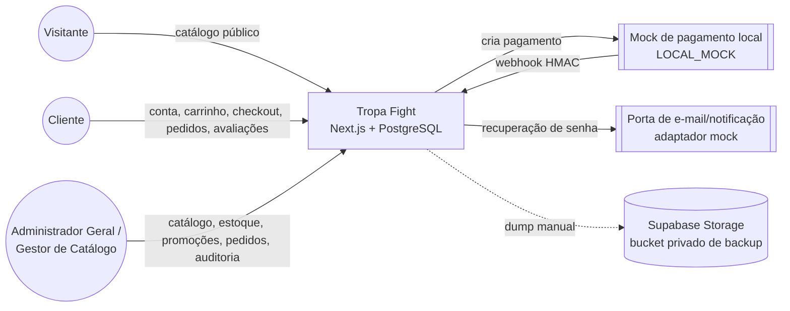
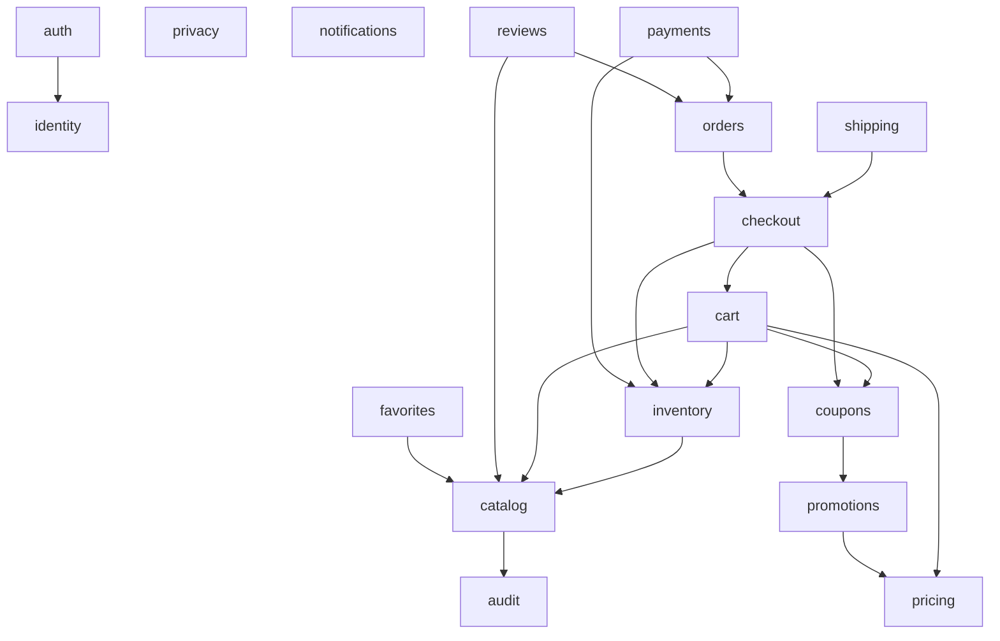

# Contexto, módulos e fluxo crítico

Diagramas derivados do código em 2026-11-05 e dos ADRs aceitos.

## Diagrama de contexto



Transportadora, gateway real, provedor de e-mail, armazenamento de imagens e monitoramento: **não escolhidos**.

## Módulos e dependências principais



As setas indicam **dependência de dados ou regra**, não imports de código. Todos os módulos usam `auth` para autorizar requisições e `audit` para registrar operações sensíveis. A composição de adaptadores pela apresentação segue o ADR-020.

## Sequência: checkout → pagamento → confirmação

```mermaid
sequenceDiagram
    actor C as Cliente
    participant API as Route Handlers
    participant CK as checkout
    participant DB as PostgreSQL
    participant PM as payments
    participant G as LocalMockPaymentGateway

    C->>API: POST /api/checkout/quotes {addressId}
    API->>CK: cotação autoritativa (preço, desconto, frete R$ 20)
    CK->>DB: expira pedidos vencidos; grava checkout_quotes
    API-->>C: cotação
    C->>API: POST /api/checkout/orders {quoteId} + Idempotency-Key
    CK->>DB: TX: revalida, cria order/items/shipment, reserva estoque (30 d), consome cupom, converte carrinho
    API-->>C: pedido PENDING_PAYMENT
    C->>API: POST /api/payments {orderId, method}
    PM->>G: cria cobrança simulada
    PM->>DB: payments PENDING
    G->>API: POST /api/payments/webhook (x-payment-signature)
    API->>PM: valida HMAC em tempo constante
    PM->>DB: TX: evento único; PROCESSING → APPROVED; pedido PAYMENT_CONFIRMED; reserva → baixa
    API-->>G: 200 (replay idempotente também 200)
```
