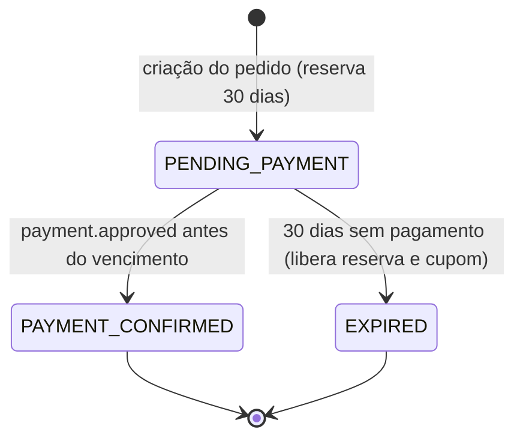
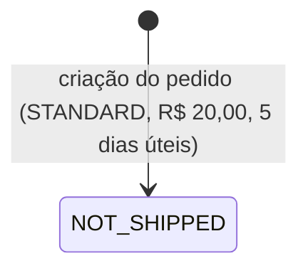
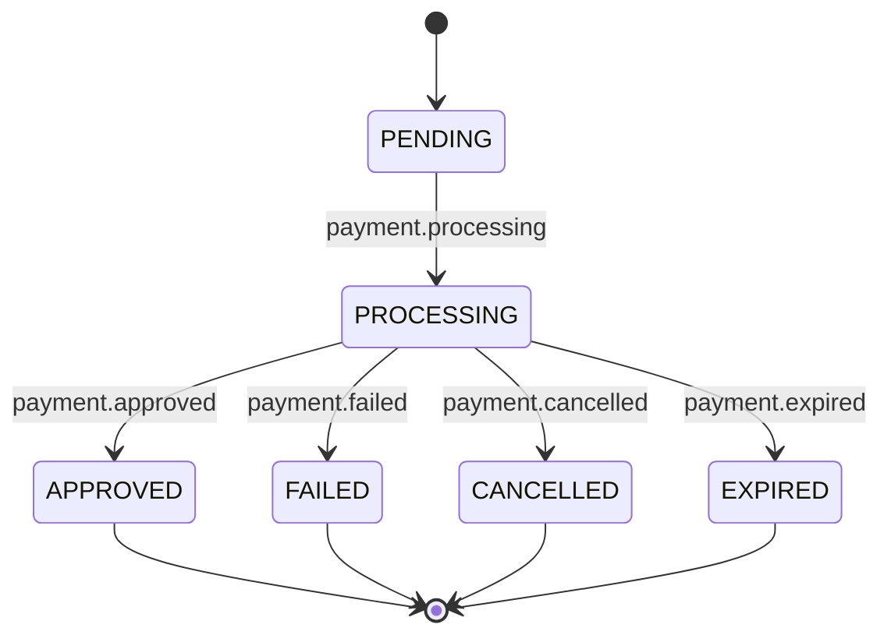
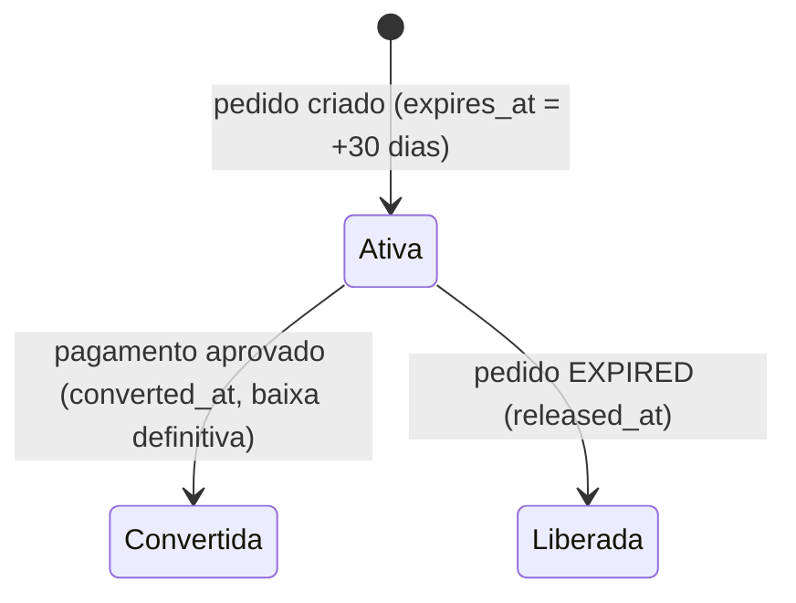
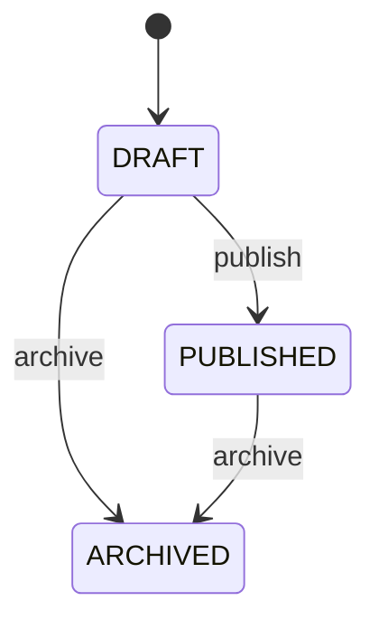
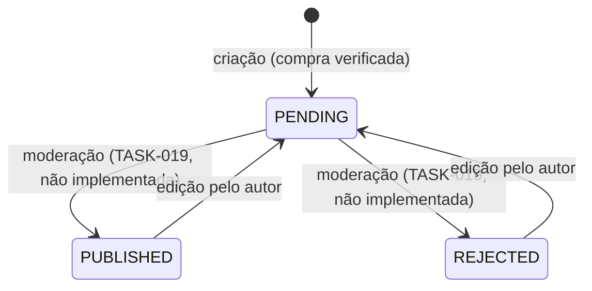

# Máquinas de estado

Estados e transições **aprovados e implementados**, conforme ADRs, decisões de TASK e enums das migrations. Estados futuros (separação, envio, entrega, cancelamento, devolução, estorno) não estão definidos e não aparecem aqui (ver ADR-009; fora da V1 por decisão de 2026-11-11).

## Pedido (`order_status`) — ADR-009, TASK-013/014/015

A expiração é aplicada durante as transações de checkout. A criação de pagamento recusa pedido vencido. Não há job agendado (ADR-013 `PROPOSED`).

## Entrega (`shipment_status`) — ADR-009/010

## Pagamento (`payment_status`) — ADR-008, TASK-014

Estados terminais não regridem. Eventos repetidos, identificados por `(provider, providerEventId)`, não duplicam efeitos.

## Reserva de estoque — ADR-005

`inventory_reservations` não possui coluna de estado. O estado é derivado de `converted_at` e `released_at`, que não podem estar preenchidos simultaneamente.

## Produto (`product_publication_state`) — TASK-006

Marcas, categorias e variantes usam `ACTIVE`/`INACTIVE`, com transição livre por edição.

## Promoção e cupom (`promotion_status`) — TASK-012

Estados: `DRAFT` (inicial), `ACTIVE` e `INACTIVE`. No código, o estado é definido por edição administrativa. O domínio declara o erro `INVALID_TRANSITION`, mas não foi localizada uma regra de transição que o utilize. Por isso, nenhum grafo de transições é afirmado aqui; consulte `docs/TASKS/TASK012.MD`.

A expiração não é um estado: ela é derivada da vigência (`startsAt <= agora < expiresAt`). Somente `ACTIVE` dentro da vigência é elegível.

## Avaliação (`review_status`) — TASK-017/019

